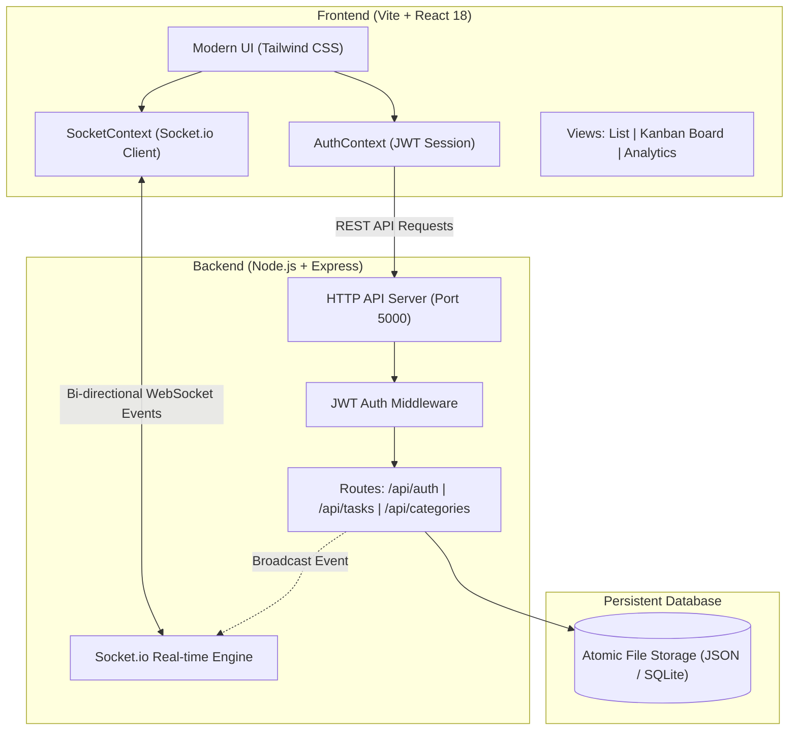

# TaskBuddy ⚡ — Full-Stack Real-Time Task Management System

> **"Your friendly task manager"** — Elevated from the reference concept into a modern, production-grade full-stack application with real-time WebSocket synchronization, JWT authentication, and interactive views.

---

## 🌟 Overview & Architectural Elevation

Inspired by the clean simplicity of the reference video and screenshot, **TaskBuddy** preserves the signature dark aesthetic, amber action buttons, and intuitive workflow, while transforming it into a complete, enterprise-grade full-stack platform:

* **Signature TaskBuddy Aesthetic**: Dark slate background (`#0b0f17`, `#121824`), warm amber/gold accents (`#f59e0b`, `#fbbf24`), progress counter (`X of Y tasks completed`), and the iconic **"Clear All Tasks"** action button.
* **Full-Stack Architecture**: Clean monorepo separation between a modern React/Tailwind frontend and a high-performance Express/Socket.io backend.
* **Real-Time Multi-Client Synchronization**: When a task is added, edited, completed, or deleted in one browser or mobile window, all connected clients update instantaneously via WebSockets without page reload.
* **User Authentication & Authorization**: Secure JWT-based authentication with bcrypt password hashing, private per-user workspaces, and a **1-Click Instant Demo Mode** for zero-friction evaluation.
* **Interactive Views**:
  * 📋 **Task List View**: Filter by status, search in real-time, category tags, priority pills, and expandable subtask checklists.
  * 📌 **Kanban Board View**: Workflow stage columns (To Do, In Progress, Completed).
  * 📊 **Analytics & Metrics**: Completion rates, priority distribution bars, category breakdown, and productivity insights.
* **Data Portability**: Export tasks to **JSON** or **CSV**, and import backups directly from the interface.

---

## 🏗️ Architecture & Component Flow



---

## 📂 Project Structure

```text
Task Buddy/
├── client/                      # React Frontend Application
│   ├── src/
│   │   ├── components/
│   │   │   ├── Navbar.jsx       # Brand header, view switcher, live sync badge, theme toggle
│   │   │   ├── TaskInput.jsx    # "Enter your task" bar, priority, category, expandable details
│   │   │   ├── TaskItem.jsx     # Task card with complete, delete, edit, subtasks & confetti
│   │   │   ├── ProgressBar.jsx  # "0 of 3 tasks completed" bar & "Clear All Tasks" button
│   │   │   ├── TaskFilterBar.jsx# Search, category filter, priority filter, CSV/JSON export/import
│   │   │   ├── TaskBoard.jsx    # Kanban board view (To Do, In Progress, Completed)
│   │   │   ├── TaskAnalytics.jsx# Performance charts, completion rate, priority distribution
│   │   │   ├── EditTaskModal.jsx# Full task editing with subtask checklist manager
│   │   │   ├── ClearAllModal.jsx# Confirmation modal for "Clear All Tasks"
│   │   │   ├── AuthModal.jsx    # Sign in, Sign up, and 1-Click Demo Account
│   │   │   └── NotificationToast.jsx # Real-time alerts and undo-delete functionality
│   │   ├── context/
│   │   │   ├── AuthContext.jsx  # JWT state, login, register, demo authentication
│   │   │   └── SocketContext.jsx# Live WebSocket connection and room sync
│   │   ├── App.jsx              # Application state, optimistic UI updates, WebSocket listeners
│   │   ├── main.jsx             # React entry point wrapped with providers
│   │   └── index.css            # Tailwind directives, animations & custom scrollbar
│   ├── dist/                    # Production bundle (Vite)
│   ├── index.html
│   ├── tailwind.config.js
│   └── vite.config.js           # API proxying to http://localhost:5000
│
├── server/                      # Express + WebSockets Backend
│   ├── data/
│   │   └── taskbuddy.json       # Persistent file-backed database
│   ├── middleware/
│   │   └── auth.js              # Bearer token verification middleware
│   ├── routes/
│   │   ├── auth.js              # /register, /login, /demo, /me
│   │   ├── tasks.js             # Task CRUD, toggle, clear-all, clear-completed, import, reorder
│   │   └── categories.js        # Category list, create, delete
│   ├── db.js                    # Database engine with seed data & atomic writes
│   ├── server.js                # Express app, HTTP server, Socket.io rooms, static file server
│   └── .env                     # Port and JWT secret configuration
│
├── package.json                 # Monorepo root with concurrent scripts
└── README.md                    # Project documentation & full-stack guide
```

---

## 🚀 Getting Started

### 1. Prerequisites
* **Node.js**: v18.0.0 or later (Tested on Node v22.19.0)
* **npm**: v9.0.0 or later

### 2. Run in Development Mode (Recommended)
From the root directory (`Task Buddy`), run:
```bash
npm run dev
```
This starts both the Express API server on `http://localhost:5000` and the Vite React client on `http://localhost:5173` with instant hot-module reloading!

### 3. Run in Production Mode
```bash
npm start
```
Starts the full-stack server on `http://localhost:5000`, serving both the REST/WebSocket API and the compiled React frontend from a single unified port!

---

## 🔑 Authentication & Demo Account

The application includes pre-configured demo credentials so you can start testing immediately without typing credentials:

* **1-Click Demo Login**: Click **"Demo Mode"** in the top navigation bar or **"1-Click Instant Demo Login"** inside the Sign In modal.
* **Manual Credentials**:
  * **Email**: `demo@taskbuddy.app`
  * **Password**: `password123`
* **Custom Accounts**: You can also register any new account via the **Sign In → Register** tab. Each account gets its own isolated tasks, custom categories, and personal WebSocket room.

---

## 📡 REST API Reference

All protected endpoints require the `Authorization: Bearer <TOKEN>` header.

### Authentication (`/api/auth`)
| Method | Endpoint | Description |
|---|---|---|
| `POST` | `/api/auth/register` | Register new user with name, email, password |
| `POST` | `/api/auth/login` | Authenticate existing user, returns JWT |
| `POST` | `/api/auth/demo` | Instant 1-click test login |
| `GET` | `/api/auth/me` | Retrieve profile and task statistics for active user |

### Tasks (`/api/tasks`)
| Method | Endpoint | Description |
|---|---|---|
| `GET` | `/api/tasks` | List tasks with filters (`status`, `priority`, `category`, `search`, `sortBy`) |
| `POST` | `/api/tasks` | Create new task (title, description, priority, category, dueDate, subtasks) |
| `GET` | `/api/tasks/:id` | Retrieve single task by ID |
| `PUT` | `/api/tasks/:id` | Update task details or subtasks |
| `PATCH` | `/api/tasks/:id/toggle` | Toggle task completion status |
| `DELETE` | `/api/tasks/:id` | Delete task by ID |
| `POST` | `/api/tasks/clear-completed` | Delete all completed tasks |
| `POST` | `/api/tasks/clear-all` | Delete all tasks (matches the reference action) |
| `POST` | `/api/tasks/import` | Bulk import tasks array |

### Categories (`/api/categories`)
| Method | Endpoint | Description |
|---|---|---|
| `GET` | `/api/categories` | Get user categories |
| `POST` | `/api/categories` | Create custom category with color & icon |
| `DELETE` | `/api/categories/:id` | Delete custom category |

---

## ⚡ Real-Time WebSocket Events (Socket.io)

When users interact with tasks, the server dispatches events to the client's room:
* `task_created`: Dispatched when a task is added.
* `task_updated`: Dispatched when a task is edited or toggled.
* `task_deleted`: Dispatched when a task is removed.
* `tasks_cleared`: Dispatched when clear-all or clear-completed is executed.
* `stats_updated`: Real-time updates to task counts and completion percentages.

---

## 🎓 Full-Stack Learning Outcomes Demonstrated

1. **REST API Design & Standards**: Clean URL patterns, idempotent HTTP methods (`GET`, `POST`, `PUT`, `PATCH`, `DELETE`), and appropriate status codes (`200 OK`, `201 Created`, `400 Bad Request`, `401 Unauthorized`, `404 Not Found`).
2. **State Management & Optimistic Updates**: The frontend applies UI changes immediately (such as toggling completion or removing a card) and rolls back automatically if the network request fails, giving the user a 60fps instant tactile response.
3. **Bi-Directional WebSockets**: Implementing room-based event broadcasting so multiple browser windows or devices synchronize in real-time.
4. **Data Persistence & Atomic Writes**: Preventing corrupted database states by writing to atomic temporary buffers before swapping files on disk.
5. **Modern Responsive Design**: Fully responsive layout adhering to modern mobile drawer patterns, flexbox grids, and dark/light color tokens.
